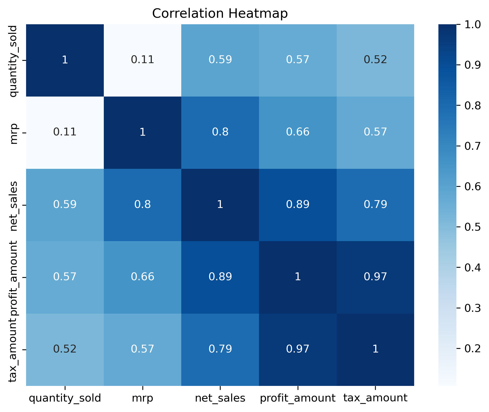

# Supermarket-Sales-Data-Analysis
End-to-End Supermarket Sales Data Analytics project using Python, Pandas, and Seaborn.  Select Public and check A
# 🛒 Supermarket Sales Data Analysis & Performance Insights

An end-to-end Data Analytics project exploring 70,000+ retail supermarket transactions, customer purchasing behavior, category profitability, payment distributions, and advanced statistical modeling using Python.

---

## 📌 Project Overview
This project performs an exhaustive, data-driven investigation into supermarket transaction records to uncover revenue trends, product margin distributions, customer segmentation patterns, and operational performance metrics. 

The analysis follows a rigorous end-to-end data analytics workflow:
- **Data Ingestion & Validation:** Importing raw transaction records, inspecting memory usage, data types, and initial row distributions.
- **Data Cleaning & Preprocessing:** Managing missing values, filtering duplicates, handling string formatting, and standardizing categorical records.
- **Feature Engineering & Transformation:** Constructing derived financial features, date-time extractions, and spending segment bins.
- **Exploratory Data Analysis (EDA):** Performing statistical summaries, pivot tables, group aggregations, and correlation matrices.
- **Advanced Statistical Visualizations:** Generating custom plots using Matplotlib and Seaborn.

---

## 🎯 Project Objectives
- Analyze monthly and seasonal sales trends across the supermarket database.
- Examine category-wise performance to identify top revenue-generating segments.
- Evaluate customer payment preferences across UPI, Cash, Card, and Wallets.
- Investigate statistical relationships and correlations between transaction metrics.

---

## ⚙️ Data Processing & Feature Engineering Highlights
To prepare the raw transactional logs for advanced analytics, several transformation steps were executed in the Python pipeline:
- **String & Categorical Standardization:** Stripping whitespace from store identifiers and normalizing customer category text values for consistency.
- **Date-Time Parsing:** Extracting granular temporal features including `order_year`, `order_month`, `order_quarter`, and day-of-week components to track cyclical buying patterns.
- **Derived Financial Metrics:** Calculating exact line-item net sales, gross profits, and net profit margins (`Net_Profit_Margin_Pct`) to evaluate product-level profitability.
- **Data Binning & Segmentation:** Grouping continuous data like MRP ranges into categorical tiers (`Low`, `Medium`, `High`) and segmenting total bill amounts into distinct customer spending brackets.

---

## 📈 Key Business Metrics & Financial Analysis
An evaluation of the key performance indicators (KPIs) extracted from the dataset reveals important operational trends:
- **Sales Volume Drivers:** Essential categories such as *Groceries* and *Staples* consistently record the highest transaction frequencies and gross sales totals.
- **Margin Elasticity:** Analysis indicates a tight coupling between unit pricing and profit realization, where controlled discounting safeguards net margins while maintaining sales velocity.
- **Payment Ecosystem Preferences:** Digital payment adoption is exceptionally strong, pointing towards shifting consumer habits in retail transaction settlement.

---

## 📑 Dataset Description
The dataset contains transaction-level retail records covering store operations, product details, and financial attributes.

| Category | Description |
| :--- | :--- |
| **Transaction Info** | Unique IDs, bill numbers, dates, times, and sales channels |
| **Store & Region** | Store name, city (Agra operations), region, and area type |
| **Customer Profiling** | Customer type, gender, age group, and loyalty membership |
| **Product Attributes** | Product names, categories, subcategories, brands, and units |
| **Financial Metrics** | MRP, selling price, discounts, net sales, and profit amounts |

---

## 🛠️ Tools & Technologies

| Tool / Library | Purpose |
| :--- | :--- |
| **Python** | Core programming language for data processing |
| **Pandas** | Data frame manipulation, grouping, and aggregations |
| **NumPy** | Vectorized mathematical operations |
| **Matplotlib** | Static plot creation and customization |
| **Seaborn** | Advanced statistical data visualizations |
| **Jupyter Notebook** | Interactive development and documentation environment |

---

## 📊 Key Visualizations

### 1. Sales by Product Category (Bar Chart)


### 2. Transaction Distribution by Payment Mode (Pie Chart)


### 3. Monthly Sales Trend (Line Plot)


### 4. Correlation Heatmap


*(Note: Ensure your 4 saved chart PNG files in the `visualizations/` folder match these exact file names).*

---

## ⚠️ Data & Analysis Considerations
- Dataset reflects historical supermarket transaction logs concentrated around Agra store operations.
- Statistical correlations identified represent observational insights rather than direct causal proofs.

---

## 🚀 Future Enhancements
- Build an interactive Streamlit or Power BI dashboard for real-time filtering.
- Implement machine learning classification models to predict customer loyalty membership.

---

## 📂 Repository Structure

```text
Supermarket-Sales-Data-Analysis/
├── visualizations/
│   ├── sales_by_category.png
│   ├── payment_mode_pie.png
│   ├── monthly_sales_trend.png
│   └── correlation_heatmap.png
├── Raw file_cart_insight_supermarket_2025_profit...csv
├── cleaned_supermarket_sales.csv
├── Data Analytics Final Project.ipynb
└── README.md

Audit Professional | Data Analytics Enthusiast
